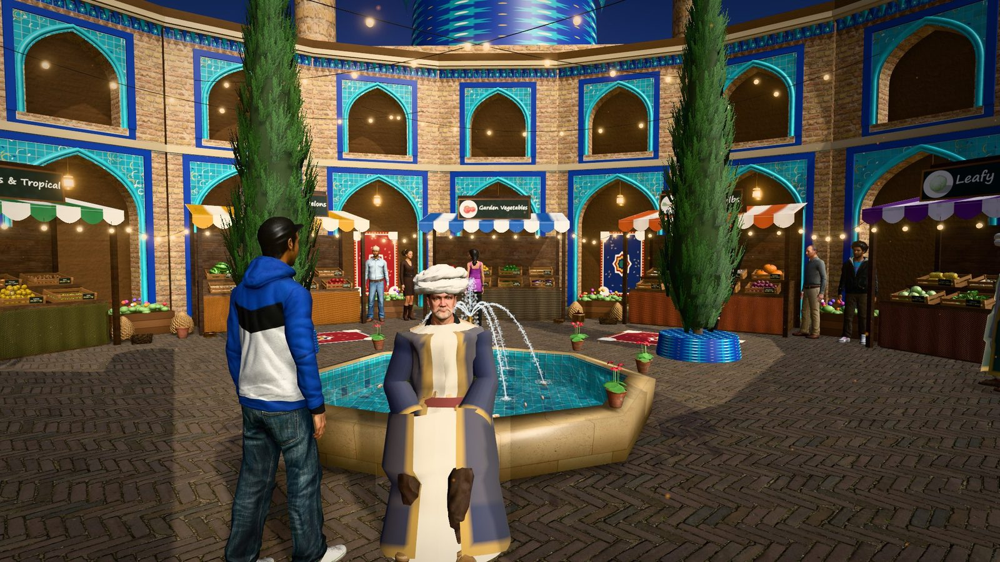
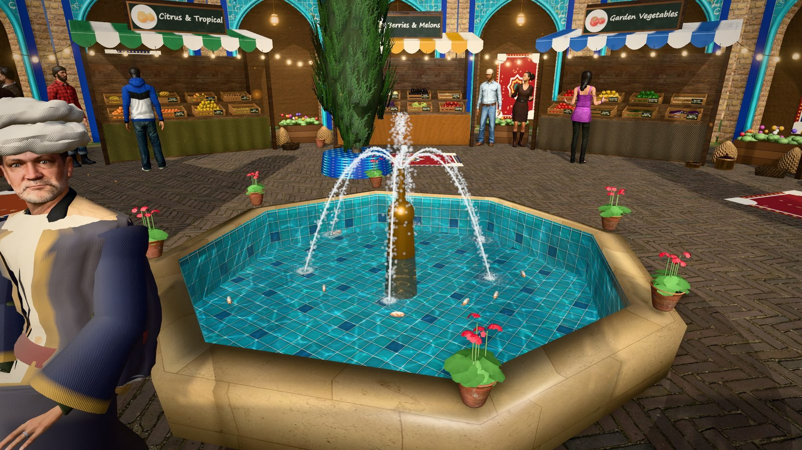
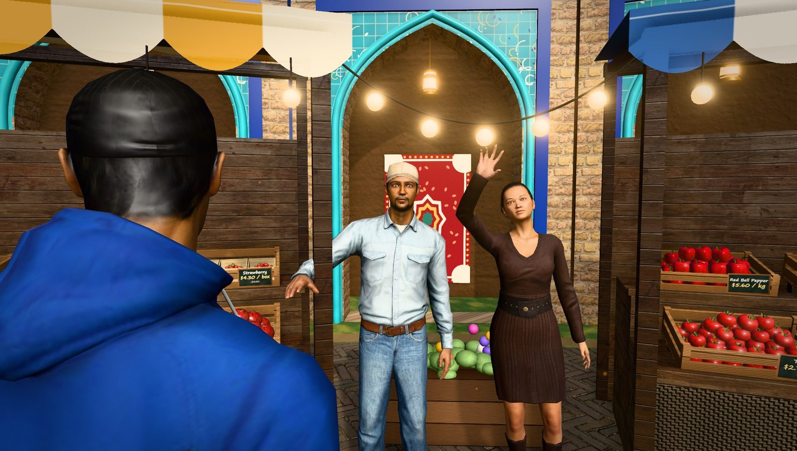
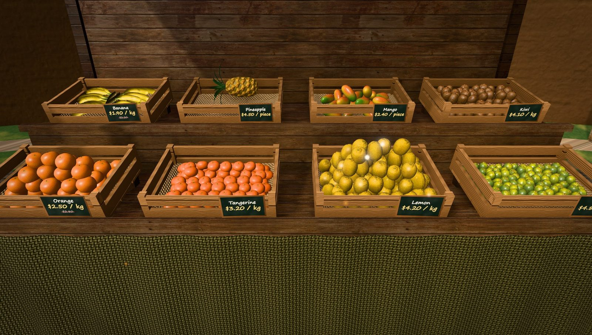

<p align="center">
  
</p>

<h1 align="center">Old Bazaar 3D</h1>

<p align="center">
  <b>A walkable, traditional Persian old bazaar as a 3D storefront for a Selldone shop.</b><br>
  A custom Selldone Layout built on the official <a href="https://github.com/selldone/storefront">selldone/storefront</a>.
</p>

<p align="center">
  
  
  
  
  
</p>

<p align="center">
  <a href="#use-it-on-your-shop"><b>Use it on your shop</b></a> ·
  <a href="#for-developers">For developers</a> ·
  <a href="FRESH-MARKET-3D.md">Engineering notes</a> ·
  <a href="https://github.com/selldone-custom-layouts">All Selldone custom layouts</a>
</p>

---

## What it is

**Old Bazaar 3D** turns a shop's home page into a real-time 3D walk through a traditional Iranian bazaar,
in the style of Kashan and Isfahan:

- **Architecture:** a courtyard of brick arcades with glazed tile frames and muqarnas cornices, a tiled portal carrying the shop's name in a calligraphy band, and a turquoise dome with minarets;
- **The courtyard itself:** an octagonal pool with a fountain, cypress trees and carpets;
- **Stalls and crates:** every category of the shop is a market stall, and every product is a crate of produce with a chalkboard price tag;
- **Shopping:** click a crate to turn the product on a studio turntable, read everything the shop knows about it, and add it to the real Selldone basket. Checkout, account, product pages and the rest of the storefront stay the standard Selldone pages.

It is alive. Vendors in work clothes greet you, follow you with their eyes and show their produce.
Shoppers walk between the stalls, look over the crates and talk to the vendors. A couple and a mother with her child walk together, and two men chat by the entrance.

Three figures from Iran's history have come to the bazaar:

- **Omar Khayyam** sits on the rim of the pool;
- **Avicenna** stands by the herbs;
- **Rhazes** stands by the fruit.

Click one and he looks at you and recites a quatrain or a saying. It appears in English with the Persian original in small type beneath each line, and is read aloud when the browser has a voice.

Everything is read from the shop: categories, titles, images, prices, discounts, units, stock, variants, descriptions, specifications, pros and cons, brand, warranty and ratings. No product is written into the code. A large category spreads across neighbouring stalls under the same sign, as a big merchant would in a real bazaar.

## Highlights

| Part | What you see |
| --- | --- |
| Arrival | A drone shot sweeps down into the courtyard; a soundscape of the fountain, the crowd's murmur and a santur playing in the Shur mode |
| The pool | An octagonal marble howz with mirror-like water that reflects the arcades, rings spreading where the streams land, foam, moving caustics on the turquoise tile, goldfish, and clay pots of red geraniums on the rim; the streams are thousands of droplets on true ballistic arcs |
| Stalls | One per category, with the category's image on the sign, awnings, string lights, weathered plank stands, and copper pots, brass trays, wicker baskets and clay pots beside them |
| Produce | Photo-scanned apples, lemons, limes, kiwis, pomegranates, avocados, onions, ginger and sweet potatoes; about forty other kinds modelled procedurally; any product the engine does not recognise appears as a labelled package with its own photo |
| Inspection | A studio turntable for the product, beside a panel with the price, discount, stock, variants, quantity, description, gallery, specifications, pros and cons, brand, warranty and SKU, and the real Add to basket |
| People | Realistic people with motion capture: walk speed matched to stride (no sliding feet), steps when turning, collision-free crowd steering, conversations, head and eye contact with you |
| Historical figures | Khayyam, Avicenna and Rhazes in period costume (robe, cloak, turban) with verses and sayings; Khayyam's quatrains include «هر سبزه که بر کنار جویی رسته است» |
| Light | A real HDR afternoon sky, photo-scanned brick, plaster, marble and paving, soft shadows, ambient occlusion and a filmic finish, with dynamic resolution that adapts to the device |
| Moving around | Drag to look, WASD or the on-screen joystick to walk, the stall bar to jump between categories, the classic list view one tap away |

## Screenshots

| | |
| --- | --- |
|  |  |
|  |  |
|  |  |

<p align="center">
  
  
</p>

## Use it on your shop

The Layout works with any Selldone shop: it reads your categories and products and builds the bazaar from them. It suits food and grocery shops best, since every fruit, vegetable and herb gets a 3D model, but any shop works.

1. **Prepare the shop.**
   - Give each top-level category a title and an image: they become the stall signs.
   - Give products a photo, a price and a unit.
   - Optionally, set the Persian name in the product's second title: it appears beneath the English name.
2. **Choose a model for a product (optional).** Add a tag such as `3d:apple-green`, `3d:herbs-mint` or `3d:pumpkin`. Otherwise the model is matched from the title, in English or Persian.
3. **Allow guest checkout** if you want shoppers to buy without signing in. Otherwise "Add to basket" asks them to sign in, the same as the standard storefront.
4. **Upload the Layout and attach it:**
   - Build and upload it with the Selldone CLI (below).
   - Pick it in **Dashboard → Settings → Domains & Home** for the domain where it should run.
   - Set the home page to *Shop* (or a landing page) so the bazaar opens first.

## For developers

```bash
git clone https://github.com/selldone-custom-layouts/official-fresh-bazaar.git
cd official-fresh-bazaar
npm install
npm run serve          # dev server; the shop comes from .env (VITE_APP_SAMPLE_SHOP_NAME)

npm install -g selldone-cli
selldone               # sign in (browser), build, package and upload a new Layout version
```

The manifest identifies the Layout (`manifest.json` → package `fresh-market-3d-storefront`). Bump `manifest.version` for every release.

Dev-only helpers:
- `?market-nointro` skips the drone shot.
- `?market-demo` opens a showroom of every 3D model with demo data.

## Where things are

| Part | Files |
| --- | --- |
| The bazaar page: HUD, loader, verse card, inspection, basket drawer | `pages/market/StorefrontPageMarket3D.vue` |
| Product panel, basket drawer, joystick | `components/market3d/MarketProductPanel.vue`, `MarketCart.vue`, `MarketJoystick.vue` |
| Catalog from the shop (every product, paged) | `components/market3d/data/marketCatalog.ts` |
| Historical figures, verses and sayings | `components/market3d/data/figures.ts` |
| Engine: renderer, post-processing, walking, picking, dynamic resolution | `components/market3d/engine/MarketEngine.ts` |
| Architecture, tiles, relief, cypresses | `components/market3d/engine/market/{persian,cypress}.ts` |
| The pool: reflective water, droplet streams, caustics, goldfish, geraniums | `components/market3d/engine/market/fountain.ts` |
| Stalls, crates, price tags, sky, plaza, string lights | `components/market3d/engine/market/{stall,crate,environment}.ts` |
| Photo-scanned materials and HDR sky | `components/market3d/engine/market/realism.ts`, `components/market3d/assets/env/` |
| Produce models (procedural + photo-scanned) and product → model matching | `components/market3d/engine/produce/` |
| People: avatars, motion capture, costume, crowd behaviour | `components/market3d/engine/people/` |
| Soundscape | `components/market3d/engine/audio/ambience.ts` |
| Asset pipeline (avatars, animations, scans) | `catalog/people-pipeline/` |
| Engineering notes | [`FRESH-MARKET-3D.md`](FRESH-MARKET-3D.md) |

## Credits

- **Storefront:** built on [selldone/storefront](https://github.com/selldone/storefront) ([licence](LICENSE.md)). Selldone's original README is kept as [`README.selldone.md`](README.selldone.md).
- **People and motion capture:** the [Microsoft Rocketbox](https://github.com/microsoft/Microsoft-Rocketbox) avatar library (MIT), see [`LICENSE-Rocketbox.txt`](components/market3d/assets/people/LICENSE-Rocketbox.txt).
- **Photo-scanned produce, props, materials and the HDR sky:** [Poly Haven](https://polyhaven.com) (CC0), see [`CREDITS.txt`](components/market3d/assets/env/CREDITS.txt).
- **Verses:** the Persian texts are classical and in the public domain. Lines traditionally attributed to a figure are labelled as attributed, and the English renderings are our own.
- **Everything else:** the architecture, produce and soundscape are procedural, generated in code at runtime.
