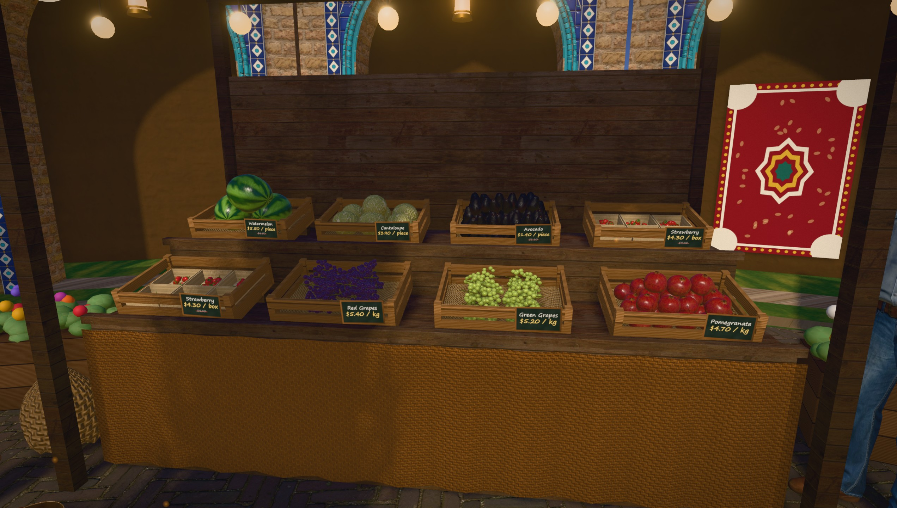
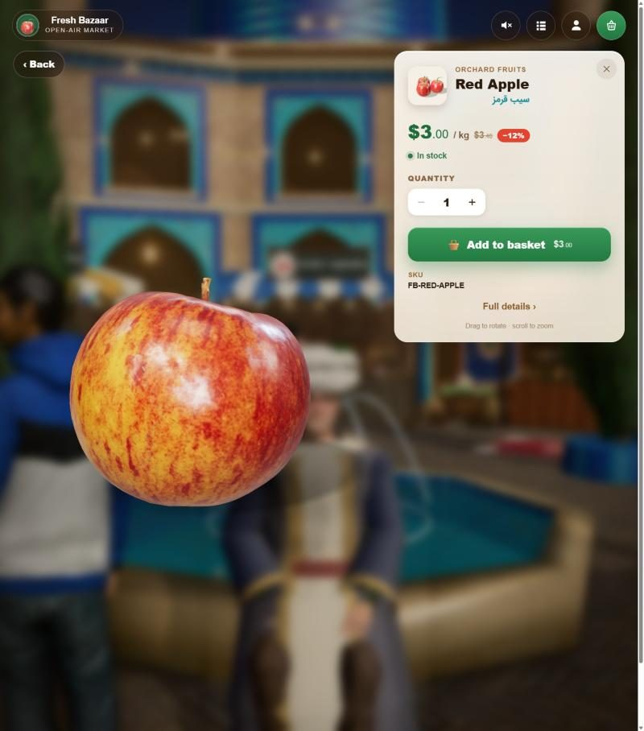
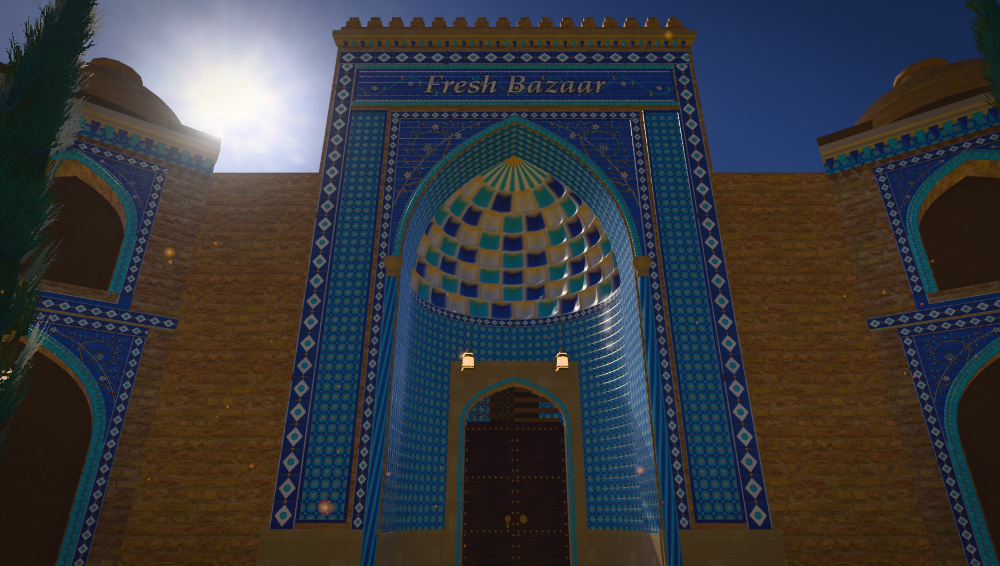
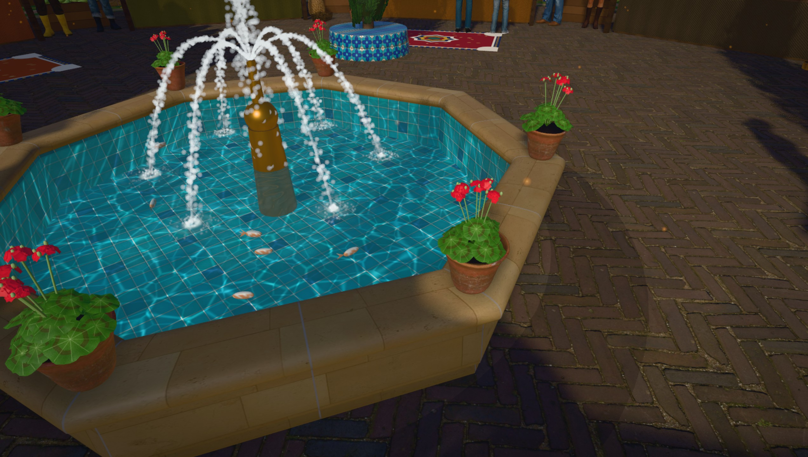
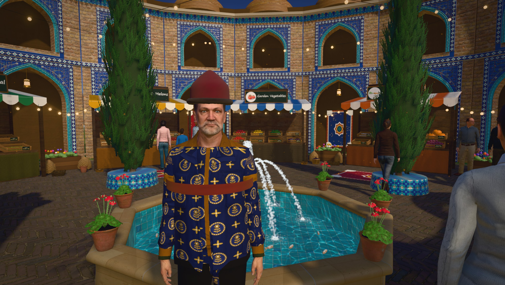
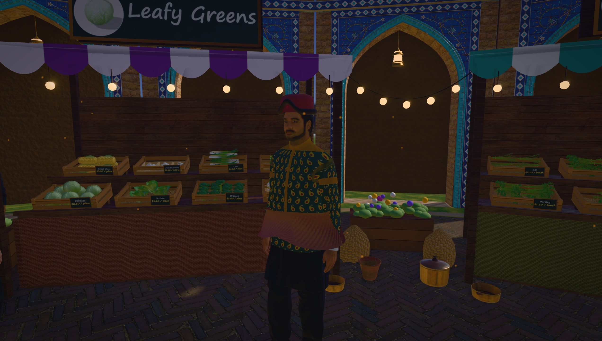
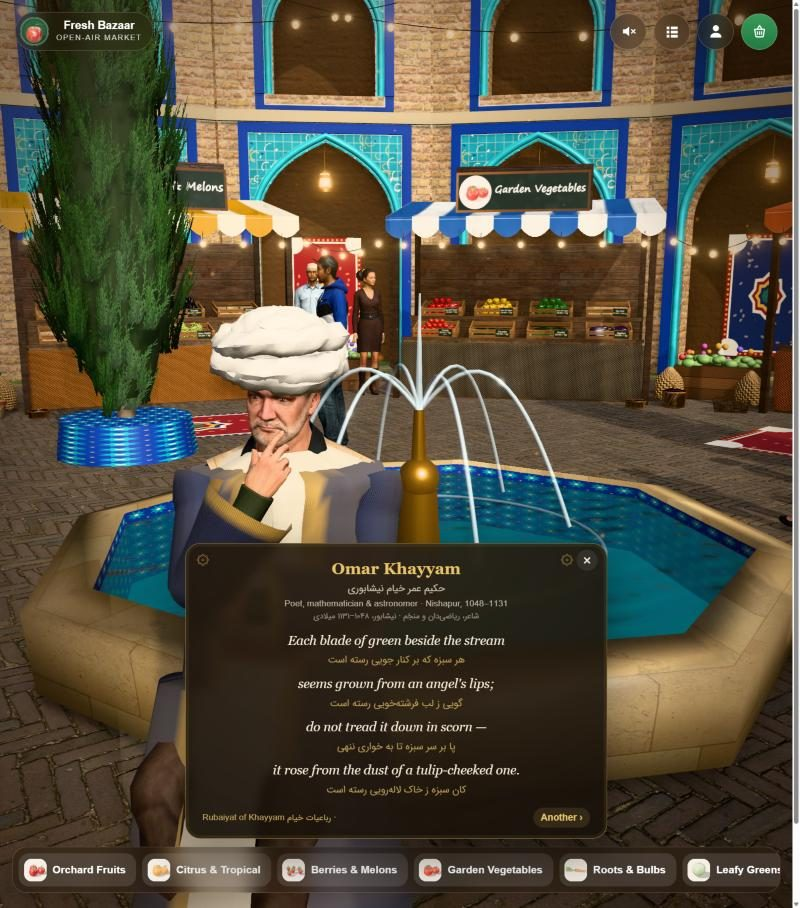

<p align="center">
  
</p>

<h1 align="center">Old Bazaar 3D</h1>

<p align="center">
  <b>A traditional Persian bazaar you can walk through, and a real shop you can buy from.</b><br>
  Every crate is a live product of a Selldone store: pick it up, add it to the basket, pay.<br>
  A custom Selldone Layout built on the official <a href="https://github.com/selldone/storefront">selldone/storefront</a>.
</p>

<p align="center">
  <a href="https://bazaar.bigmart.me"></a>
  <a href="https://github.com/selldone-custom-layouts/official-fresh-bazaar/wiki"></a>
  <a href="https://github.com/selldone-custom-layouts/official-fresh-bazaar/wiki/Install-with-AI"></a>
  
  
  
  <br>
  
  
  
</p>

<p align="center">
  <a href="https://bazaar.bigmart.me"><b>Walk into the live bazaar</b></a> ·
  <a href="https://github.com/selldone-custom-layouts/official-fresh-bazaar/wiki/The-AI-Experiment">The AI experiment</a> ·
  <a href="https://github.com/selldone-custom-layouts/official-fresh-bazaar/wiki/Install-with-AI">Set it up with AI</a> ·
  <a href="https://github.com/selldone-custom-layouts/official-fresh-bazaar/wiki/Manual-Setup">Manual setup</a> ·
  <a href="https://github.com/selldone-custom-layouts">All Selldone custom layouts</a>
</p>

---

## Today → the goal

The picture above is the whole idea of this project.

- **Today:** what runs in your browser right now. A real-time 3D scene: three.js, a photographed HDR sky, photo-scanned materials and produce, motion-captured people, all at 60 frames a second on an ordinary laptop or phone.
- **The goal:** the same frame, indistinguishable from a photograph of a real bazaar.

**How far can AI and 3D engines go, and how fast, until a screenshot of this bazaar *is* a photograph?**
We rebuild the scene with every new AI model, Claude and Codex, and keep each result. The gap between the render and a photograph is the benchmark.

## This is a real shop

<table>
<tr>
<td width="50%"></td>
<td width="50%"></td>
</tr>
</table>

**[bazaar.bigmart.me](https://bazaar.bigmart.me)** is a working Selldone store, *Fresh Bazaar*, and this Layout is its storefront.

- **Nothing is hard-coded.** Categories become stalls; every product becomes a crate of produce. Titles, photos, prices, discounts, units, stock, variants, descriptions, specifications, reviews: all are loaded live from the shop.
- **Everything works.** Click a crate to turn the product on a studio turntable and read everything the shop knows about it. Add it to the real basket, check out and pay with the shop's payment methods. Your orders and account work as in any Selldone store.
- **Any shop can wear it.** Point the Layout at your own Selldone shop and the bazaar rebuilds itself from your catalogue. Grocery and food shops look best, because every fruit, vegetable and herb has a 3D model, but any shop works.

## An ongoing experiment with AI

This is not a finished product. It is an **ongoing project**. Each time a new AI model ships, we sit it down in front of this repository and ask it to make the bazaar more real, then keep what it builds.

| Round | What the models added |
| --- | --- |
| The first walk | A walkable courtyard of brick arcades, a stall per category, a crate per product, live prices, a basket that is the shop's real basket |
| People | Microsoft Rocketbox avatars with motion capture: stride-matched walking, steering crowds, conversations, eye contact |
| History | Khayyam, Avicenna and Rhazes, who recite when you click them: in English, with the Persian original beneath |
| Water and light | A mirror pool with ring waves, droplet streams on true ballistic arcs and moving caustics; an HDR sky, a physically sized sun, soft shadows |
| Craft | Haft-rang tilework generated tile by tile, a bazaar gate with a muqarnas half-dome built tier by tier, a tiled inscription bearing the shop's name in raised glaze |
| Dress | The figures re-dressed in Seljuk-era Persian silk (pearl roundels, termeh, tiraz bands), fitted to the body, with period hats |
| *Next* | *Whatever the next model can do. The right half of the picture is the brief.* |

How the rounds are run, and how to compare them, is in the wiki: **[The AI experiment](https://github.com/selldone-custom-layouts/official-fresh-bazaar/wiki/The-AI-Experiment)**.

## Inside the bazaar

<table>
<tr>
<td width="50%"></td>
<td width="50%"></td>
</tr>
<tr>
<td width="50%"></td>
<td width="50%"></td>
</tr>
</table>

| Part | What you see |
| --- | --- |
| Arrival | A drone shot sweeps down into the courtyard, over a soundscape of the fountain, the crowd's murmur and a santur in the Shur mode |
| The gate | A tiled pishtaq: a tile inscription with the shop's name in raised white glaze, islimi spandrels, twisted colonnettes, a muqarnas half-dome closing in a sunburst, and a studded walnut door with its two knockers |
| Architecture | Brick arcades with haft-rang tile frames, bazaar domes with skylights and Yazd windcatchers: a market, not a monument |
| The pool | An octagonal dressed-stone howz with mirror water, ring waves, foam, caustics on turquoise tile, goldfish, and clay pots of geraniums on the rim |
| Stalls | One per category, with the category's image on the sign, awnings, string lights, copper pots, brass trays and wicker baskets |
| Produce | Photo-scanned apples, lemons, limes, kiwis, pomegranates, avocados, onions, ginger and sweet potatoes; about forty more kinds modelled procedurally; any other product appears as a labelled package with its own photo |
| People | Real people with real motion: vendors greet you and follow you with their eyes, shoppers browse and talk, a mother walks with her child |
| Historical figures | Khayyam, Avicenna and Rhazes in fitted Persian silk, with quatrains and sayings in English and Persian, read aloud |
| Moving around | Drag to look; WASD or the on-screen joystick to walk; the stall bar to jump between categories; the classic list view one tap away |

<p align="center">
  
</p>

## Use it on your shop

| Wiki page | What it covers |
| --- | --- |
| [Install with AI](https://github.com/selldone-custom-layouts/official-fresh-bazaar/wiki/Install-with-AI) | A prompt to paste into Claude Code or Codex, and the few steps only you do (CLI sign-in, 2FA) |
| [Manual Setup](https://github.com/selldone-custom-layouts/official-fresh-bazaar/wiki/Manual-Setup) | Fork, install, `.env`, dev server, the manifest |
| [Shop Requirements](https://github.com/selldone-custom-layouts/official-fresh-bazaar/wiki/Shop-Requirements) | What your categories and products need to make a good bazaar |
| [Build and Upload](https://github.com/selldone-custom-layouts/official-fresh-bazaar/wiki/Build-and-Upload) | Releasing a version with the Selldone CLI |
| [Go Live](https://github.com/selldone-custom-layouts/official-fresh-bazaar/wiki/Go-Live) | A domain on Cloudflare, attaching the version, verification |
| [Customize](https://github.com/selldone-custom-layouts/official-fresh-bazaar/wiki/Customize) | Where each part of the bazaar lives in the code |
| [The AI experiment](https://github.com/selldone-custom-layouts/official-fresh-bazaar/wiki/The-AI-Experiment) | Why this project exists, and how each model round is run |
| [Troubleshooting](https://github.com/selldone-custom-layouts/official-fresh-bazaar/wiki/Troubleshooting) | Performance, a blank page, an old version showing |

## For developers

```bash
git clone https://github.com/selldone-custom-layouts/official-fresh-bazaar.git
cd official-fresh-bazaar
npm install
npm run serve          # dev server; the shop comes from .env (VITE_APP_SAMPLE_SHOP_NAME)
```

Dev-only helpers: `?market-nointro` skips the drone shot; `?market-demo` opens a showroom of every 3D model.

## Where things are

| Part | Files |
| --- | --- |
| The bazaar page: HUD, loader, verse card, inspection, basket drawer | `pages/market/StorefrontPageMarket3D.vue` |
| Product panel, basket drawer, joystick | `components/market3d/MarketProductPanel.vue`, `MarketCart.vue`, `MarketJoystick.vue` |
| Catalogue from the shop (every product, paged) | `components/market3d/data/marketCatalog.ts` |
| Historical figures, dress, verses and sayings | `components/market3d/data/figures.ts` |
| Engine: renderer, post-processing, walking, picking, dynamic resolution | `components/market3d/engine/MarketEngine.ts` |
| Architecture, the gate, tilework | `components/market3d/engine/market/{persian,portal,tilework,arch}.ts` |
| The pool: water, streams, caustics, stone rim, geraniums | `components/market3d/engine/market/fountain.ts` |
| Sky, sun, plaza, string lights | `components/market3d/engine/market/environment.ts` |
| Produce models and product → model matching | `components/market3d/engine/produce/` |
| People: avatars, motion capture, re-dressing, crowd behaviour | `components/market3d/engine/people/` |
| Asset pipeline (avatars, animations, scans) | `catalog/people-pipeline/` |
| Real product and category photos for the demo shop (cutout + shared studio backdrop) | [`catalog/real-photos/`](catalog/real-photos/README.md) |
| Engineering notes | [`FRESH-MARKET-3D.md`](FRESH-MARKET-3D.md) |

## Credits

- **Storefront:** built on [selldone/storefront](https://github.com/selldone/storefront) ([licence](LICENSE.md)). Selldone's original README is kept as [`README.selldone.md`](README.selldone.md).
- **People and motion capture:** the [Microsoft Rocketbox](https://github.com/microsoft/Microsoft-Rocketbox) avatar library (MIT), see [`LICENSE-Rocketbox.txt`](components/market3d/assets/people/LICENSE-Rocketbox.txt).
- **Photo-scanned produce, props, materials and the HDR sky:** [Poly Haven](https://polyhaven.com) (CC0), see [`CREDITS.txt`](components/market3d/assets/env/CREDITS.txt).
- **Demo-shop product and category photos:** real photographs from Wikimedia Commons and Openverse (CC0, public domain, CC BY, CC BY-SA), see [`catalog/real-photos/CREDITS.md`](catalog/real-photos/CREDITS.md).
- **Verses:** the Persian texts are classical and in the public domain; lines traditionally attributed to a figure are labelled as such, and the English renderings are our own.
- **Everything else** (the architecture, tilework, gate, pool, produce, fabrics and soundscape) is generated in code at runtime.
- **Built with** [Claude Code](https://claude.com/claude-code) and [Codex](https://openai.com/codex), one model generation at a time.
