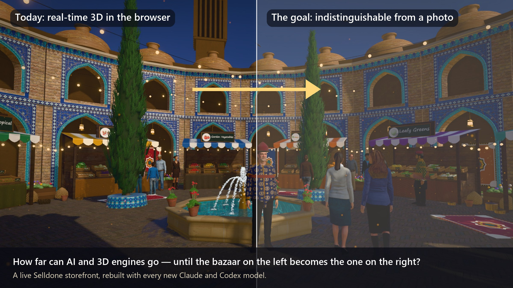

# Old Bazaar 3D

**Old Bazaar 3D** is a custom storefront **Layout** for Selldone shops: a traditional Persian bazaar you walk through in 3D, in which every stall is a category of a real shop and every crate is one of its products. Click a crate, read everything the shop knows about the product, add it to the basket and pay: the basket, checkout, payments, orders and account are Selldone's own, running underneath.

It runs live on **[bazaar.bigmart.me](https://bazaar.bigmart.me)**, the storefront of the Selldone shop *Fresh Bazaar*.

It is also an **ongoing experiment**: with every new AI model (Claude, Codex) we ask how much closer the bazaar can come to a photograph. See [The AI experiment](The-AI-Experiment).

## Start here

| I want to… | Page |
| --- | --- |
| Understand why this project exists | **[The AI experiment](The-AI-Experiment)** |
| Have an AI agent set it up on my shop | **[Install with AI](Install-with-AI)** |
| Set it up myself | [Manual Setup](Manual-Setup) |
| Know what my shop's data needs | [Shop Requirements](Shop-Requirements) |
| Build and upload a release | [Build and Upload](Build-and-Upload) |
| Put it live on my shop and domain | [Go Live](Go-Live) |
| Change the bazaar | [Customize](Customize) |
| Fix a problem | [Troubleshooting](Troubleshooting) |

## How a Selldone Layout works (one minute)

1. A **Layout** is a complete storefront app (Vue 3) that Selldone serves instead of its default storefront.
2. You build it and **upload** it to your Selldone developer account with the official [selldone-cli](https://github.com/selldone/cli). Each upload is a new **version**.
3. You **attach** a version to your shop or to one of its domains.
4. Selldone injects **your** shop into the Layout: products, categories, prices, stock, theme, languages, payments. Nothing about Fresh Bazaar is written into the code.

## What is in the bazaar

- **The gate:** a tiled pishtaq with the shop's name in a tile inscription, a muqarnas half-dome and a studded walnut door.
- **The courtyard:** brick arcades with haft-rang tilework, bazaar domes and windcatchers, a dressed-stone pool with a fountain, goldfish and geraniums, cypresses and carpets.
- **Stalls and crates:** one stall per category, one crate per product, photo-scanned or modelled produce, chalkboard prices.
- **People:** motion-captured vendors and shoppers, and three figures from Iran's history (Khayyam, Avicenna, Rhazes) who recite verses when clicked.
- **Shopping:** a product inspector with the live price, stock, variants, description, specifications and reviews, and the real Add to basket.

## Links

- Live shop: <https://bazaar.bigmart.me>
- Repository: <https://github.com/selldone-custom-layouts/official-fresh-bazaar>
- All custom Layouts: <https://github.com/selldone-custom-layouts>
