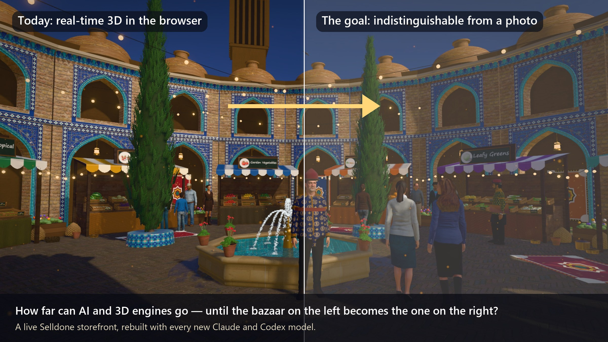

# The AI experiment

## The question

**How far can AI and real-time 3D engines go, and how fast, until a walkable shop in a browser looks like a photograph?**

Old Bazaar 3D is our yardstick. The left half of the picture above is what the bazaar renders today, live, at 60 frames a second. The right half is the same frame as a photograph would show it. Every new AI model gets the same brief: *close the gap*.

## The rules of a round

1. **Same repository, new model.** Each round starts from the current `main`, with the newest Claude model (in Claude Code) or Codex model.
2. **Plain-language briefs.** The owner describes what feels unreal ("the shadows are too black", "the clothes look inflated", "make the gate real") the way a client would. The model chooses the technique.
3. **Real constraints.** The result must still be a working Selldone storefront: products, prices and the basket come from the live shop, checkout and payments stay Selldone's, and it must run in an ordinary browser on an ordinary device.
4. **Free assets only.** Open licences only: Microsoft Rocketbox (MIT) for people, Poly Haven (CC0) for scans and the sky; everything else is generated in code.
5. **Keep the evidence.** Each round leaves its commits, screenshots and notes ([`FRESH-MARKET-3D.md`](https://github.com/selldone-custom-layouts/official-fresh-bazaar/blob/main/FRESH-MARKET-3D.md)), so rounds can be compared.

## What the rounds have added so far

| Round | Highlights |
| --- | --- |
| The first walk | Courtyard, stalls per category, crates per product, live prices, the real basket |
| People | Rocketbox avatars with motion capture, stride-matched walking, crowd steering, conversations, eye contact |
| History | Khayyam, Avicenna and Rhazes reciting in English with the Persian original beneath |
| Water and light | Mirror pool, ballistic droplet streams, ring waves, caustics; HDR sky, a physically sized sun, softened shadows |
| Craft | Haft-rang tile generator (grout, pillowed and tilted tiles, crazing, chips), the bazaar gate with a muqarnas half-dome generated tier by tier, a raised-glaze tile inscription |
| Dress | Figures re-dressed in their own fitted clothes re-woven in Persian silk, with period hats |

## Techniques worth stealing

- **Re-dressing instead of over-dressing.** To put a character in period dress without an inflated, layered look, keep the avatar's own artist-made garment (its fit, folds and skinning are real) and swap only the cloth in the shader: project the new fabric round the torso and arms in centimetres, keep the original folds as relative brightness, and add trims by position.
- **Garment collision with body capsules.** Measure each avatar's limbs as capsules from its skin weights, update them from the skeleton every frame, and push cloth out along its own normal with a soft (smooth-max) contact.
- **A muqarnas generator.** Tiers of concave, hooded niche cells, every other tier offset by half a cell, the plan following the arch profile so the vault meets the opening exactly.
- **Tiles as tiles.** Draw the pattern in cuerda-seca colours, then finish it per tile: grout, a pillowed and slightly tilted face, glaze variation, crazing, chipped corners, glossy glaze against matte grout.
- **A believable sun.** Clip the HDR sky's sun pixels and draw a physically sized, limb-darkened disc with a forward-scattering halo, so bloom gives glare rather than a white ball.

## Take part

Run a round with your own model: fork the repository, open it in your agent, and give it one thing that still looks unreal. Then send a pull request with before/after screenshots.
